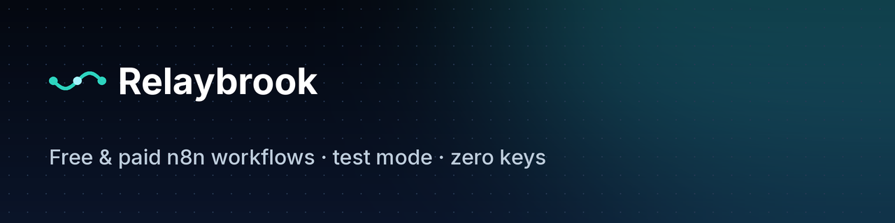

# Relaybrook: free n8n workflows

Free, ready-to-import [n8n](https://n8n.io) workflows for lead research, lead-list cleanup, inbox triage and content repurposing.

Relaybrook builds practical n8n automations for freelancers, agencies and small teams. Every workflow here uses only core n8n nodes (no community nodes), keeps credentials out of the JSON, and works with free tools where it can: plain HTTP, JavaScript, and any OpenAI-compatible AI API (Google Gemini's free tier by default, or Groq, OpenAI, OpenRouter or a local Ollama).

## Workflows

| Workflow | What it does | Needs |
|---|---|---|
| [Website to AI company summary](workflows/website-to-ai-company-summary/) | Turns a company URL into a research card: pitch, summary, industry, B2B/B2C, tech stack, LinkedIn, public emails and 3 outreach hooks. | AI API key |
| [Lead list cleaner](workflows/lead-list-cleaner/) | Cleans and deduplicates a lead list from Google Sheets or CSV: name casing, email typo fixes, free-mail/role/disposable flags, company domains, ready/review status. | Nothing (Google Sheets optional) |
| [Gmail AI inbox triage](workflows/gmail-ai-inbox-triage/) | Rules first, AI second: labels bulk mail without AI, gives everything else a category, priority and summary, and saves reply drafts in the thread. Never sends. | Gmail + AI API key |
| [Article to social content pack](workflows/article-to-social-content-pack/) | Turns article URLs into a LinkedIn post, numbered X thread, newsletter blurb and key points, with a number fact check and X length checks. Exports Markdown. Never posts. | AI API key |

Each folder has a `workflow.json` and a README with setup steps, a test mode and known limitations.

## Quick start

1. Run n8n. These workflows were built and tested on self-hosted n8n 2.47.7 (Docker or npm); they use core nodes only and should also import into n8n Cloud.
2. Download the `workflow.json` you want (or clone this repo).
3. In n8n, open **Workflows → Import from File** and pick the file.
4. For AI workflows: get an API key (for example from Google AI Studio, aistudio.google.com), then create a **Header Auth** credential with Name `Authorization` and Value `Bearer YOUR_KEY`, and select it in the workflow's AI node.
5. Follow the workflow's README to run its test mode first, then point it at your own data.

Using a different AI provider? Change `llm_base_url` and `llm_model` in the workflow's settings node, for example `https://api.groq.com/openai/v1` or `http://localhost:11434/v1` (Ollama).

## Honest notes

- AI output can be wrong. The workflows check and flag what they can, but review anything before it goes to a customer or gets posted.
- Each README lists what was tested and what wasn't yet (for example, live Gmail or Google Sheets connections). Found a bug? Please open an issue.
- No credentials, API keys or personal data are included. Sample data uses made-up names and `.example` domains.

## Want more?

I build and sell larger n8n packs under the Relaybrook name. If the free workflows are useful, the paid packs go further:

- [AI Lead Enrichment Pack for n8n](https://relaybrook.bytesell.app/products/ai-lead-enrichment-pack-for-n8n?utm_source=github): batch enrichment from Sheets/CSV, ICP scoring, inbound-lead reply drafts, dedupe and hot-lead alerts.
- [AI Inbox Triage Pack for n8n](https://relaybrook.bytesell.app/products/ai-inbox-triage-pack-for-n8n-sort-prioritise-draft-replies-gmail-outlook-imap?utm_source=github): sort, prioritise and draft replies for Gmail, Outlook and IMAP.
- [Content Repurposing Pack for n8n](https://relaybrook.bytesell.app/products/content-repurposing-pack-for-n8n-article-youtube-linkedin-x-newsletter-calendar?utm_source=github): article and YouTube to LinkedIn, X, newsletter and a content calendar.
- [AI Automation Bundle for n8n](https://relaybrook.bytesell.app/products/ai-automation-bundle-for-n8n-lead-enrichment-inbox-triage-content-repurposing-20-workflows?utm_source=github): all three packs in one bundle.

The free workflows here are complete on their own; you don't need to buy anything to use them.

## License

[MIT](LICENSE). Use, modify and share freely.

---

n8n is a trademark of n8n GmbH. Relaybrook is not affiliated with, endorsed by or sponsored by n8n GmbH.

## Want the full versions?

These free workflows are part of Relaybrook. Production-ready packs (AI lead enrichment, inbox triage, content repurposing) are at https://relaybrook.bytesell.app. Launch offer: 10% off every pack with code CRYPTO10 until Nov 30, 2026 (crypto checkout).
